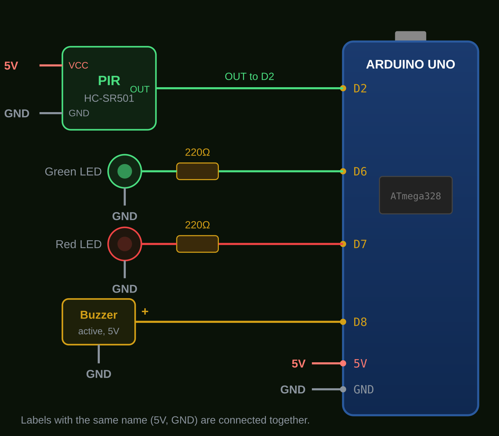

# Smart Field Alert System (Agriculture)

  

An Arduino-based smart sensor system that protects agricultural fields by detecting animals or intruders and alerting the farmer instantly with LEDs and a buzzer.

**Live demo:** https://sohan-rana.github.io/Smart-Field-Alert-System-Agriculture/

The demo page (English and Bangla) includes the project explanation, circuit diagram, interactive simulation, cost calculator, limitations and the full Arduino code.

## Features

- Detects motion in the field with a PIR sensor
- Red LED + buzzer alert when motion is detected
- Green LED shows the normal / secure state
- 30-second PIR warm-up at start-up (no false alarms)
- Serial Monitor messages only when the state changes
- Optional versions with an ultrasonic distance check and GSM SMS alerts
- Low cost and easy to build

## Components

| No. | Component | Qty | Purpose |
|-----|-----------|-----|---------|
| 1 | Arduino Uno | 1 | Main controller |
| 2 | PIR Motion Sensor (HC-SR501) | 1 | Detects infrared motion |
| 3 | Active Buzzer (5V) | 1 | Sound alert |
| 4 | LED (Red + Green) | 2 | Alert / normal indicator |
| 5 | 220 ohm Resistor | 2 | Current limiting for the LEDs |
| 6 | Breadboard | 1 | Circuit connections |
| 7 | Jumper Wires | ~15 | Connections |
| 8 | Power Supply (USB or 7-12V adapter) | 1 | Powers the Arduino |

The website has a cost calculator where you can enter your own local prices.

## Pin Connections

| Component | Arduino Pin | Notes |
|-----------|-------------|-------|
| PIR OUT | D2 | PIR VCC to 5V, PIR GND to GND |
| Green LED | D6 | Through a 220 ohm resistor, cathode to GND |
| Red LED | D7 | Through a 220 ohm resistor, cathode to GND |
| Buzzer (+) | D8 | Other leg to GND. Use an **active** buzzer |

Full diagram: [`wiring/circuit-diagram.svg`](wiring/circuit-diagram.svg) (PNG: [`wiring/circuit-diagram.png`](wiring/circuit-diagram.png)).



## How It Works

1. The PIR sensor detects infrared motion in the field.
2. It sends a HIGH signal to the Arduino on pin D2.
3. The Arduino decides what to do:
   - **Motion detected:** red LED ON, buzzer ON, green LED OFF
   - **No motion:** green LED ON, red LED OFF, buzzer OFF

Block diagram: [`docs/block-diagram.svg`](docs/block-diagram.svg)

## Upload the Code

1. Open `arduino/smart_field_alert/smart_field_alert.ino` in the Arduino IDE.
2. Select **Tools > Board > Arduino Uno** and the correct port.
3. Click **Upload**.
4. Open the Serial Monitor at **9600 baud** to see the messages.

> After power-on, wait about 30 seconds while the green LED blinks. The PIR sensor is calibrating.

### Other versions

| Folder | What it adds |
|--------|--------------|
| [`arduino/smart_field_alert_ultrasonic`](arduino/smart_field_alert_ultrasonic) | Alert only when motion is detected **and** an HC-SR04 measures an object closer than a set distance; buzzer stops after 10 s |
| [`arduino/smart_field_alert_gsm`](arduino/smart_field_alert_gsm) | SMS alert to the farmer through a SIM800L module (at most one SMS per minute) |

These two sketches have **not been tested on hardware yet**. Compile and test them on your own board before relying on them. The SIM800L needs its own 3.7-4.2V supply (about 2A peaks).

## Limitations

- One HC-SR501 covers only a limited range and angle, so large fields need several units.
- A PIR sensor cannot tell an animal from a person or other moving heat sources.
- Strong sunlight, hot wind or temperature changes can cause false alarms.
- The basic version needs a 5V supply and alerts only at the device.

## Testing

Record your own measurements (detection range, response time, false alarms) in [`docs/test-log.md`](docs/test-log.md). The full written report is in [`docs/project-report.md`](docs/project-report.md).

## Demo Photos and Video

Add `images/circuit-photo.jpg` and `images/demo.mp4` (see [`images/README.md`](images/README.md)). The website shows a Demo section automatically when they exist.

## Project Structure

```
.
├── index.html                          # Project website (GitHub Pages)
├── arduino/
│   ├── smart_field_alert/              # Basic version (PIR + LEDs + buzzer)
│   ├── smart_field_alert_ultrasonic/   # PIR + HC-SR04 version
│   └── smart_field_alert_gsm/          # PIR + SIM800L SMS version
├── wiring/                             # Circuit diagram (SVG + PNG)
├── docs/                               # Report, block diagram, test log
├── images/                             # Your photos and demo video
├── LICENSE
└── README.md
```

## Future Improvements

- Camera module to capture images of intruders
- Solar power for remote fields
- Mobile app or Telegram notifications using an ESP32 / NodeMCU
- LCD / OLED display for status messages

## License

[MIT](LICENSE) &copy; 2026 Sohan Rana

## Author

Sohan Rana
